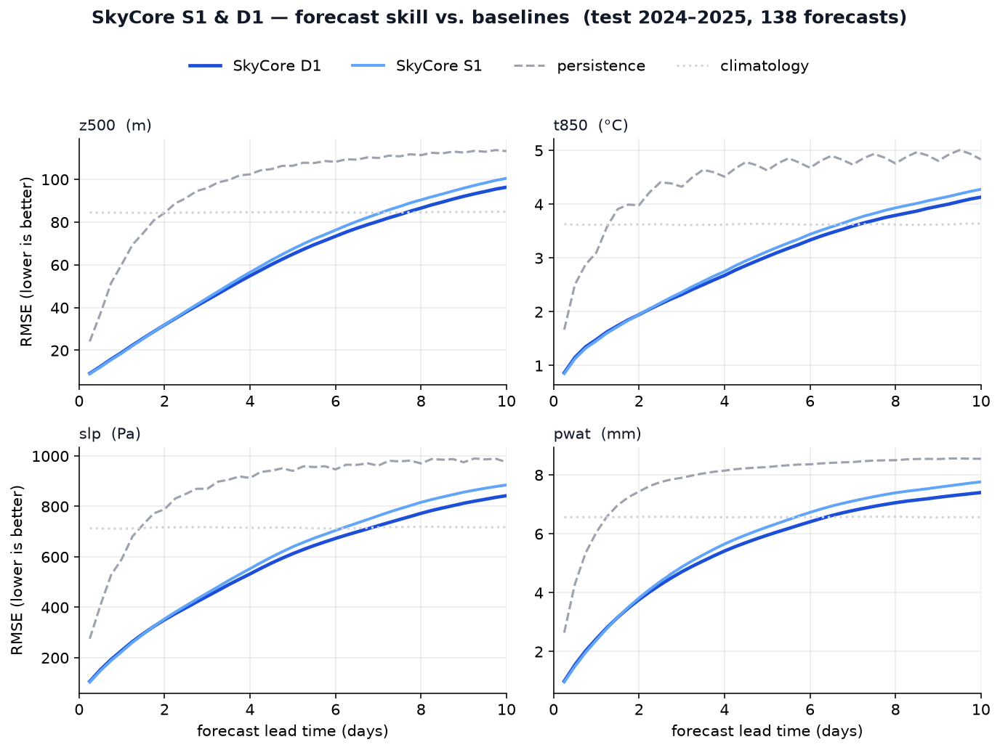

<div align="center">

# 🌍 SkyCore

### Tiny, from-scratch global weather forecasting models you can actually run

A family of open-source [GraphCast](https://www.science.org/doi/10.1126/science.adi2336)-style neural weather models — small enough to train on a **single GPU in a few hours**, yet they forecast the whole planet out to **10 days** and **beat persistence and climatology at every lead**.

[](LICENSE)

[](https://github.com/SkyCore-lab/SkyCore/stargazers)


**One file. No pretrained weights. No third-party model code. Just `python skycore.py`.**

</div>

---

## ✨ Why SkyCore

- 🪶 **Tiny.** W1 is ~0.7M parameters. The whole project is a single readable `skycore.py` — data prep, model, training, scoring, forecasting.
- ⚡ **Runs on one GPU.** Trains from scratch in hours, not weeks. Memory auto-fits the batch to your card and recovers from out-of-memory on its own.
- 🌐 **Global, 10 days.** 2.5° grid (73×144), 6-hour steps, 17 atmospheric variables, autoregressive rollout.
- 📈 **Actually skillful.** Beats persistence and climatology on every variable and lead (see the chart).
- 🔓 **Fully open.** Apache-2.0 code *and* weights. Trained only on openly licensed (CC0) data.
- 🧩 **Two backends.** PyTorch and JAX (TPU), verified to compute the same thing — weights are interchangeable.

## 🤖 The models

| Model | Size | Aim |
|---|---|---|
| **S1** | width 192, depth 12 | standard |
| **D1** | width 192, depth 24 + 8-step rollout finetune | stronger medium-range ("DeepThink") |
| **W1** | width 96, depth 8 (~0.7M params) | small, open base — [full project ›](https://github.com/SkyCore-lab/SkyCore-WeModelsProject) |

## 📊 Forecast skill

RMSE vs. forecast lead time — **lower is better.** The models (blue) stay well under *persistence* ("tomorrow = today") and *climatology* ("the seasonal normal") all the way to 10 days. D1 edges ahead of S1 in the medium range, exactly as designed.



<sub>Test 2024–2025, 138 forecasts. Headline numbers (RMSE): z500 @5d — **D1 65 m / S1 67 m** vs. persistence 106 m; t850 @5d — **D1 3.0 °C** vs. persistence 4.6 °C. Anomaly correlation (ACC ≥ 0.6) stays useful to ~5.5 days for z500.</sub>

> **Note on comparability.** S1/D1 and W1 are scored on a coarse 2.5° grid against different ground truth, so their numbers are **not directly comparable to each other**, nor to GraphCast or operational high-resolution models. Read each as confirmation that the model genuinely forecasts the weather.

## 🚀 Quickstart

```bash
git clone https://github.com/SkyCore-lab/SkyCore.git
cd SkyCore

# forecast with a released model (weights are already in weights/<model>/)
python skycore.py forecast --model d1 --data ./data --out ./weights/d1

# re-score a model against its own test period
python skycore.py evaluate --model s1 --data ./data --out ./weights/s1
```

Missing libraries (numpy / torch / eccodes, …) install themselves on first run; the first data download takes a while, then it's cached.

## 📦 What's in here

| Path | Role |
|---|---|
| `skycore.py` | Inference / scoring / forecasting in one file |
| `weights/s1/`, `weights/d1/`, `weights/w1/` | `model.pt` + `scores.json` for each model |

## 🌱 Fork it

W1 is built to be forked — small, fast, and fully documented in the **[We Models project](https://github.com/SkyCore-lab/SkyCore-WeModelsProject)**. Train your own variant, add variables, push to a finer grid. PRs and experiments welcome.

**If this is useful, a ⭐ helps others find it.**

## 📄 License

- Code and all released weights are **Apache-2.0**.
- All models are trained only on openly licensed (public-domain / CC0) data.
